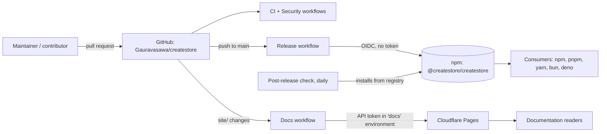
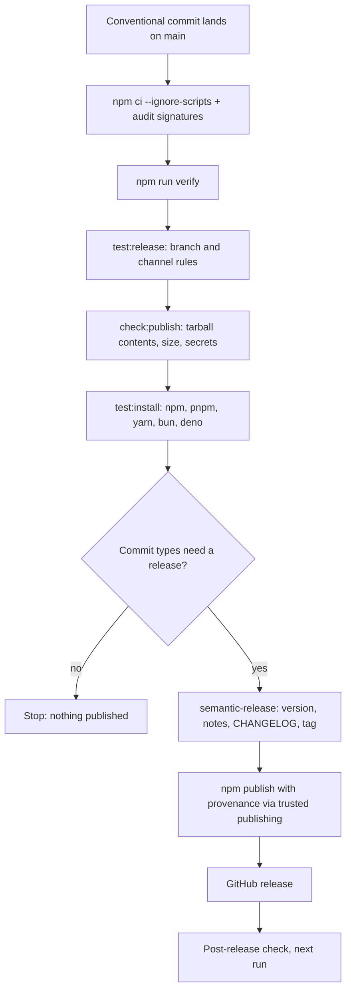
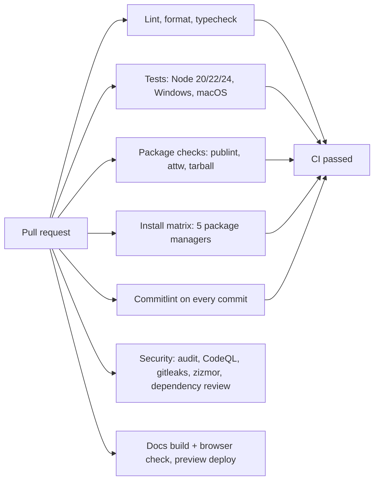
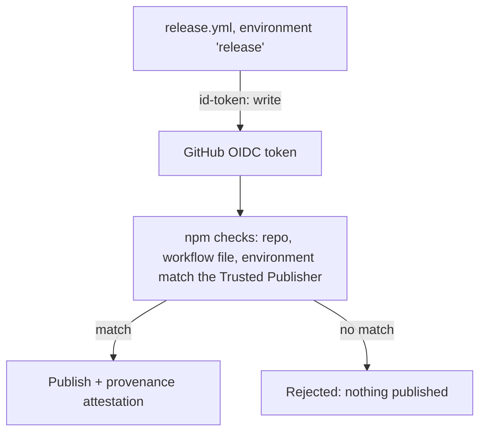
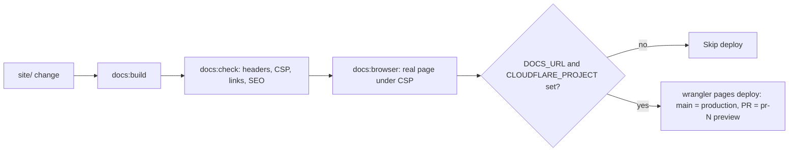

# Final audit (Phase 17)

Written 2026-11-11, from what I read and ran: `npm run verify` passes locally, the CI and Security runs on GitHub, and the
files in this repository. Scores are my judgement, not a measurement. Anything I did not verify is listed under
"Not verified".

## Architecture

## Release flow

## CI/CD flow

## Publishing flow

## Documentation deployment flow

## Scores (out of 10)

| Area                 | Score | Why                                                                                                                                   |
| -------------------- | ----- | ------------------------------------------------------------------------------------------------------------------------------------- |
| Production readiness | 6     | Verified locally and the gates are strong, but there has been no real release, no green run on `main` yet, and docs sections are thin |
| Security             | 8     | No runtime dependencies, no npm token, trusted publishing, pinned actions, scanners. Held back by settings that are not yet enforced  |
| Documentation        | 4     | README has a quick start only. The site is one page and is behind the library. No API reference, FAQ, migration or troubleshooting    |
| Performance          | 7     | Size budget enforced, tree-shaking tested, stress tests pass. No published benchmark, and no real-world measurement                   |
| Maintenance          | 6     | Policies, templates, runbook and Dependabot exist. One maintainer, and major dev-tool bumps are piling up                             |

## Phase status

| Phase | Topic                   | Status                                                                                                                                             |
| ----- | ----------------------- | -------------------------------------------------------------------------------------------------------------------------------------------------- |
| 12    | Cloudflare Pages deploy | Code done. Needs your Cloudflare account, project, token and the two repository variables                                                          |
| 13    | Documentation quality   | **Not done.** Only a one-page site and the README. Missing: API reference, examples, FAQ, migration, troubleshooting, performance, roadmap pages   |
| 14    | Contributor experience  | Done in this change (CONTRIBUTING, CODE_OF_CONDUCT, SECURITY, SUPPORTED_VERSIONS, issue, PR and discussion templates)                              |
| 15    | Monitoring              | Done: smoke and install tests, pre-publish gate, daily Post-release check. Download monitoring and error tracking are recommendations only (below) |
| 16    | Disaster recovery       | Done: [RECOVERY.md](../RECOVERY.md), all 8 scenarios                                                                                               |
| 17    | Final audit             | This file                                                                                                                                          |

## Monitoring recommendations (not automated)

- **Downloads:** npmjs.com package page, or the public API `https://api.npmjs.org/downloads/point/last-week/@createstore/createstore`.
  Watch for a sudden jump, which can mean a dependency chain change or an attack.
- **Error tracking:** this is a library, so errors happen in consumers' apps. Make them easy to report: the issue
  template asks for versions and a reproduction. Do not add telemetry to the package; that would break the "no
  dependencies, no network" promise.
- **Dependents:** GitHub's Insights, Dependency graph, Dependents shows who uses the package.

## Remaining risks

1. **No successful release yet.** The release pipeline has never run end to end. `test:release` failed in CI on the
   first attempt (fixed, not yet re-run on GitHub).
2. **Single maintainer.** One person holds GitHub, npm and Cloudflare. A lost security key without saved recovery codes
   means being locked out. Keep codes offline, and add a second maintainer before heavy adoption.
3. **Settings not enforced by code.** Branch and tag rules, required reviewer on `release`, private vulnerability
   reporting, secret scanning and the Dependency graph are manual switches (see security-controls.md). Until they are
   on, they protect nothing.
4. **The release job runs dev tooling** (`semantic-release`) while holding the publish credential. A compromised dev
   dependency that executes there could publish. Mitigations: lockfile hashes, no install scripts, a 7-day Dependabot
   cooldown, a required reviewer.
5. **Documentation lags the library** (Phase 13), including undocumented behaviour that the checker reports.
6. **`getState('__proto__')`** returns `Object.prototype` (known issue in security-controls.md).
7. **Dependabot major bumps** (eslint 10, tsup 9, jsdom 30, conventional-changelog 10) are open. They fail CI until
   handled one at a time.
8. **The support policy is a proposal** I wrote. Check that you are willing to keep the promises in
   SUPPORTED_VERSIONS.md.
9. **Cloudflare API token expiry.** The token in the `docs` environment expires. Put the date in a calendar.
10. **The Node 24.9 laptop** cannot run `test:release` locally (semantic-release needs 24.10 or later). CI is fine.

## Not verified

- Whether the GitHub Actions runs are green after the latest fixes: they are not pushed.
- The Post-release check workflow and the new issue and discussion templates have not run on GitHub, and I had no
  `actionlint` or `zizmor` to lint the new workflow locally. The existing Security job will do it on the first push.
- npm and Cloudflare screens, which change over time.
- Performance beyond the existing tests and size budget.
